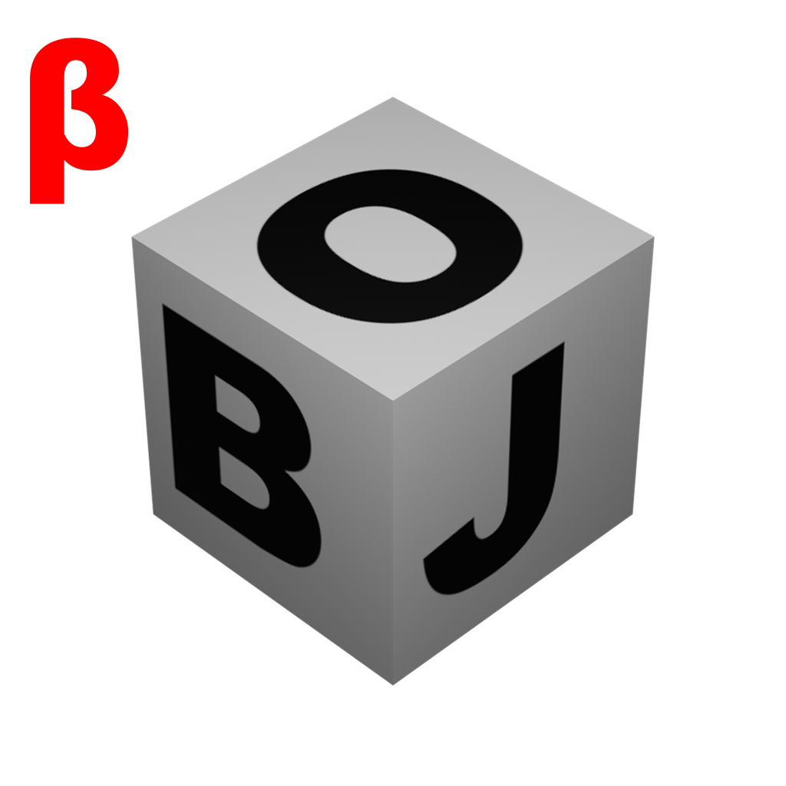

<p align="center">
  
</p>

# Betafront

Wavefront `.obj` block models for Minecraft Beta mods. Betafront comes in two builds that share one OBJ parser:

- **Better Than Adventure** 8.0.1, on [HalpLibe](https://github.com/Turnip-Labs/bta-halplibe). This is the main target.
- **Regular Babric** (Beta 1.7.3), on [StationAPI](https://github.com/ModificationStation/StationAPI).

Both read the same model JSON as NeoForge's `neoforge:obj` loader, so models made for modern NeoForge carry over with few edits.

**New here?** The [documentation](docs/README.md) covers installing, adding a model step by step, a worked example and known limitations.

> **AI disclaimer:** most of this mod's code and documentation was written with the help of Claude, an AI assistant by Anthropic, and reviewed by the author. The OBJ parsing code is adapted from NeoForge (see [Licence](#licence)). Please report anything that looks wrong as an issue.

## Repository layout

| Folder | What it is |
| --- | --- |
| `core/` | The OBJ and MTL parser, with its tests. Plain Java, no game code. Compiled into both mod jars |
| `bta/` | The Better Than Adventure mod (`betafront-bta-<version>+8.0.1.jar`) |
| `stationapi/` | The StationAPI mod for Babric b1.7.3 (`betafront-stationapi-<version>.jar`) |

Each folder is its own Gradle build, because the two games need different Loom setups. They share the Gradle wrapper in the repository root.

## Dependencies

### Better Than Adventure build

| Dependency | Version | Notes |
| --- | --- | --- |
| Better Than Adventure | 8.0.1 | Client side; the mod only changes rendering |
| Fabric Loader (BTA fork) | 0.18.4-bta.11 or newer | Comes with the BTA Babric instance |
| [HalpLibe](https://github.com/Turnip-Labs/bta-halplibe) | 6.2.0+8.0.1 or newer | Required |
| [ModMenu](https://github.com/Turnip-Labs/ModMenu) | 5.0.2 | Optional |
| Java | 17 or newer | |

### StationAPI build

| Dependency | Version | Notes |
| --- | --- | --- |
| Minecraft | Beta 1.7.3 | Client side |
| [Babric](https://github.com/babric/prism-instance) (Fabric Loader for beta) | 0.19.3 or newer | |
| [StationAPI](https://modrinth.com/mod/stationapi) | 2.0.0-alpha.6.5 or newer | Required |
| Java | 17 or newer | |

### To build

| Dependency | Version |
| --- | --- |
| JDK to run Gradle | 21 or newer |
| JDK to compile | 17 (Gradle finds or downloads it) |
| Gradle | 9.5.1 (wrapper included) |
| Fabric Loom | 1.15-SNAPSHOT (BTA), 1.17.20 with babric-loom-extension 1.17.5 (StationAPI) |
| biny mappings (StationAPI only) | b1.7.3+e1fe071 |
| JUnit Jupiter (core tests) | 5.10.2 |

## The model JSON

Both builds use the same JSON:

```json
{
  "loader": "betafront:obj",
  "model": "examplemod:models/block/lamp.obj",
  "flip_v": true,
  "textures": {
    "particle": "examplemod:block/lamp",
    "texture0": "examplemod:block/lamp"
  }
}
```

### Options

| Key | Default | What it does |
| --- | --- | --- |
| `loader` | required | `betafront:obj` (`neoforge:obj` and `forge:obj` are accepted too) |
| `model` | required | The `.obj` file, relative to the namespace's asset folder |
| `mtl_override` | none | Use this `.mtl` instead of the file's `mtllib` line |
| `textures` | none | Texture map. `usemtl #texture0` or MTL `map_Kd #texture0` refers to `texture0` here |
| `flip_v` | `false` | Use `1 - v`. Blender and Blockbench exports usually need `true` |
| `automatic_culling` | `true` | Faces lying flat on a block side are hidden by a solid neighbour on that side |
| `shade_quads` | `true` | Apply the game's per-direction face shading |
| `emissive_ambient` | `true` | An MTL `Ka` above 0 makes that material glow (average of Ka, 0 to full bright) |
| `ambient_occlusion` | `true` | StationAPI only: use smooth lighting when the player has it on. Not a NeoForge option |

### Textures

- The simplest setup needs no `.mtl` at all: name the material `#texture0` in your modelling tool (`usemtl #texture0`) and map `texture0` in the JSON. A missing `.mtl` file named by `mtllib` is ignored.
- With an `.mtl`, `map_Kd` can be a texture id (`examplemod:block/lamp`) or a reference to the JSON texture map (`#texture0`).
- Faces with no material, or a material without `map_Kd`, use `#default` and then `#particle`.

### Supported OBJ features

- `v`, `vt`, `vn`, `f` (including negative indices and `v//vn`), `o`, `g`, `s`, `usemtl`, `mtllib`.
- Triangles, quads and larger polygons. Larger polygons are fan-split, so they should be convex.
- MTL: `newmtl`, `Kd`, `Ka`, `map_Kd`, `d`, plus `neoforge_TintIndex`/`betafront_TintIndex` for block colour tinting (StationAPI only for now).
- Coordinates are block units: `0` to `1` fills one block.

Not supported yet: entity and block-entity rendering, per-vertex colours (`vc`), MTL colour tints (`Kd` is read but not applied), group visibility toggles.

## Using it in a BTA mod

Put the files under `assets/<modid>/`:

```
assets/examplemod/models/block/lamp.json
assets/examplemod/models/block/lamp.obj
assets/examplemod/textures/block/lamp.png
```

Then register the model from your client entrypoint:

```java
ObjModels.block(ExampleBlocks.LAMP, "examplemod:block/lamp");

// or turned by metadata, in degrees clockwise seen from above (like a blockstate's "y")
ObjModels.block(ExampleBlocks.RAMP, "examplemod:block/ramp", meta -> new int[] {180, 270, 0, 90}[meta & 3]);
```

The block's item is drawn with the same model. Blocks with an OBJ model are usually not full cubes, so their `BlockLogic` should return `false` from `isSolidRender()` and `isCubeShaped()`. Otherwise neighbouring faces get hidden behind it.

Models are read from the mod jars on the classpath; texture packs can't replace them yet.

## Using it in a StationAPI mod

Write the model JSON as usual under `assets/<modid>/stationapi/models/`, with `"model": "examplemod:stationapi/models/block/lamp.obj"`. Blockstate files don't change; they point at this JSON like any other model, including `x`/`y` rotations. Item models work the same way in `models/item/`. Texture ids work like StationAPI JSON models: `examplemod:block/lamp` is `assets/examplemod/stationapi/textures/block/lamp.png`.

Override `isOpaque()` and `isFullCube()` to return `false` on blocks with an OBJ model.

## Example content

In the development clients both builds register two test blocks:

- `betafront:example_crystal`: a crystal cluster exported from Blender, with no `.mtl` (uses `usemtl #texture0`).
- `betafront:obj_ramp`: a ramp that turns to face the player, to check rotations and culling.

They are not registered in a normal game.

Getting them in game: in BTA they are in the creative inventory under Miscellaneous. Beta 1.7.3 has no creative mode or single-player commands, so the StationAPI dev client adds two crafting recipes instead: one dirt gives 4 example crystals, and one cobblestone gives 4 ramps.

## Building

### In IntelliJ IDEA

Open the repository folder (not one of the subfolders) and let IntelliJ import the Gradle project; it picks up all three builds. Then pick a run configuration from the dropdown at the top:

- **Run Client (BTA)**: the Better Than Adventure dev client with the example blocks
- **Run Client (Babric)**: the StationAPI dev client with the example blocks
- **Core Tests**: the parser tests
- **Build All**: tests plus both mod jars

Use the debug button instead of run to stop at breakpoints. Set IntelliJ's Gradle JVM to Java 21 or newer (Settings > Build, Execution, Deployment > Build Tools > Gradle).

### From a terminal

Run these from the repository root:

```
./gradlew buildAll                # tests plus both mod jars
./gradlew runClientBta            # same as -p bta runClient
./gradlew runClientBabric         # same as -p stationapi runClient
./gradlew -p core test            # parser unit tests
./gradlew -p bta build            # BTA mod jar in bta/build/libs
./gradlew -p bta runClient        # BTA dev client with the example blocks
./gradlew -p stationapi build     # StationAPI mod jar in stationapi/build/libs
./gradlew -p stationapi runClient # StationAPI dev client with the example blocks
```

## Contributing

New contributors and AI agents: start with [KNOWLEDGE.md](KNOWLEDGE.md), which explains the layout, the build, the BTA API names that work, and the project conventions.

## Roadmap

Next up are smooth lighting for OBJ faces, publishing to a Maven repository, and a few small performance wins. See [ROADMAP.md](ROADMAP.md).

## Licence

LGPL-2.1-only, see [LICENSE](LICENSE). The OBJ tokenizer, parser, material library and quad baking are adapted from [NeoForge](https://github.com/neoforged/NeoForge) 1.21.1 (Forge Development LLC and contributors, LGPL-2.1-only); those files keep their original headers and list the changes made.
